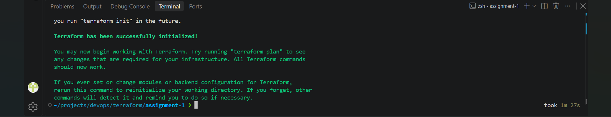
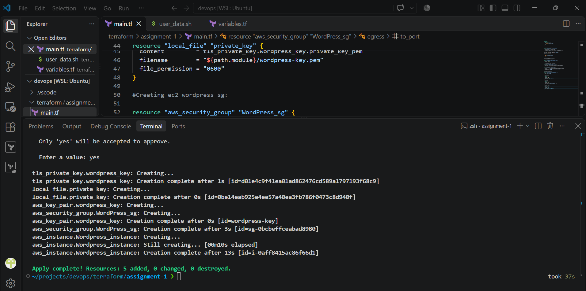
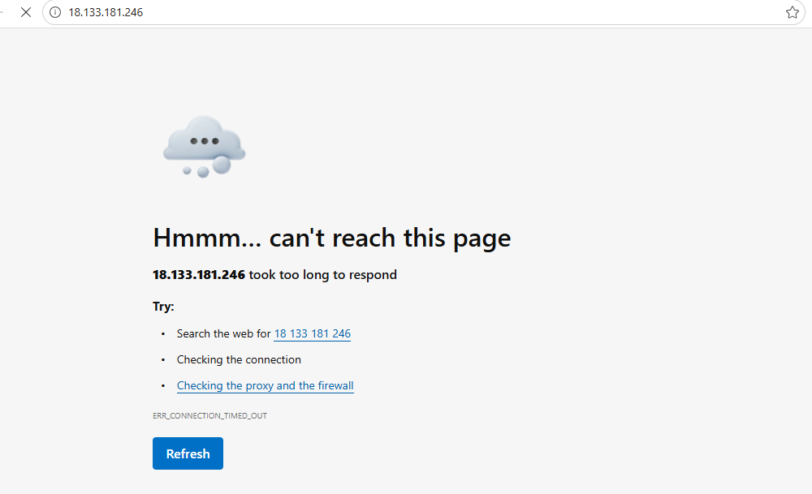
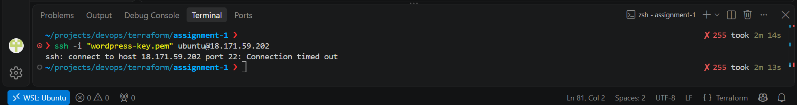
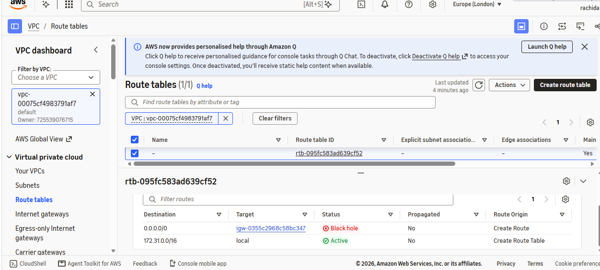
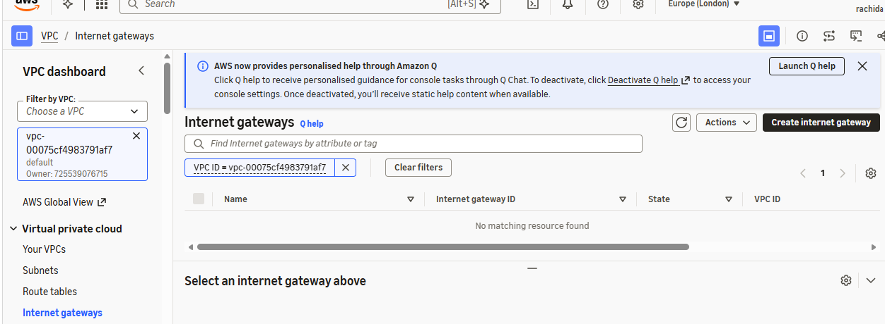
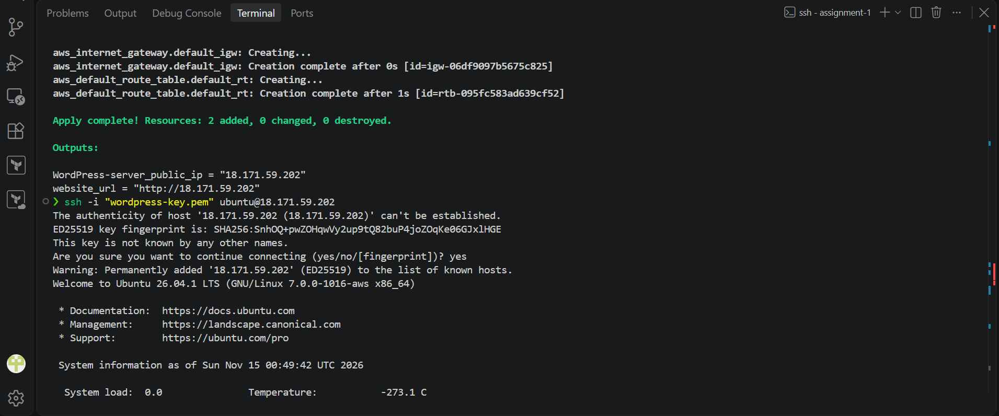
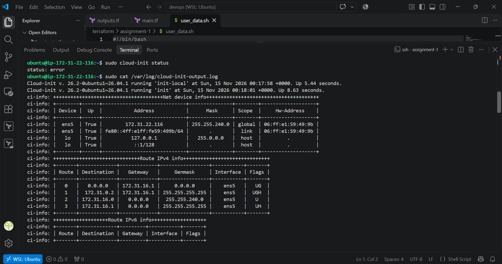
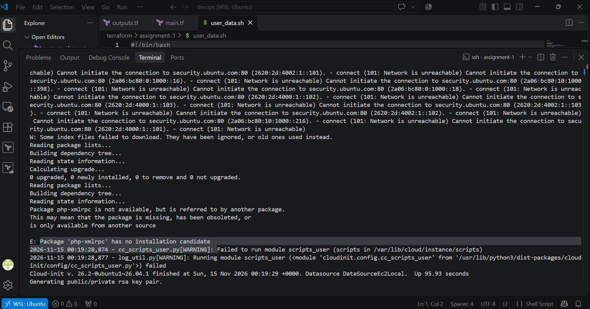
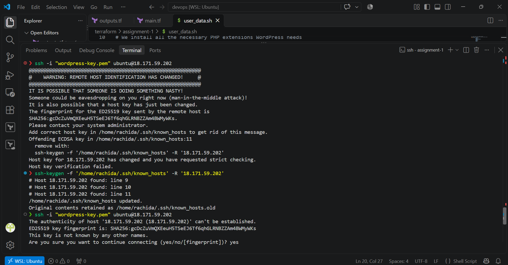

<div align="center">
  <h1>Deploying WordPress on AWS with Terraform</h1>

  
  
  
  
  
  
  
  
</div>

## Overview
This project uses Terraform to provision a complete WordPress stack on AWS. It includes networking (VPC, Subnet, Internet Gateway), security configurations, an EC2 instance, and a Bash `user_data` script that automatically installs and configures Apache, PHP, MariaDB, and WordPress on boot.

## Project Structure

assignment-1-wordpress/

├── main.tf               
├── variables.tf          
├── outputs.tf            
├── user_data.sh         
├── .gitignore            
└── screenshots/

## How to Deploy
```
1. Ensure you have the AWS CLI configured with your credentials.
2. Initialize the Terraform directory:
   terraform init
   ```


3. Review the execution plan:
   ```bash
   terraform plan
   ```
4. Apply the configuration:
   ```bash
   terraform apply
   ```

   
5. Wait 2-3 minutes for the `user_data` script to complete, then open the URL printed in the outputs.

## Issues Hit and How I Fixed Them

During the deployment, I encountered several real-world infrastructure issues that required troubleshooting:

### 1. The VPC "Black Hole" (No Internet Gateway)
* **The Issue:** The instance was created successfully, but SSH and HTTP connections were timing out.





* Checking the AWS Console revealed the default VPC's Route Table had a `Black hole` status for the `0.0.0.0/0` route, and there was no Internet Gateway (IGW) attached.




  
* **The Fix:** I added Terraform resources to create a custom VPC, a Public Subnet, an Internet Gateway, and a Route Table. I associated the Subnet with the Route Table and attached the Security Group and EC2 instance to this new network environment.



### 2. Cloud-Init Script Failed (`E: Package 'php-xmlrpc' has no installation candidate`)
* **The Issue:** The EC2 instance launched, but the website would not load. SSHing into the server and running `sudo cloud-init status` showed `status: error`.



*    Looking at `/var/log/cloud-init-output.log` revealed that the `user_data.sh` script crashed because Ubuntu 26.04 (Resolute) no longer has the `php-xmlrpc` package available in its default repositories.


  
* **The Fix:** I modified `user_data.sh` to remove `php-xmlrpc` from the `apt-get install` list. Because the script used `set -e` (which stops the script on the first error), removing the broken package allowed the rest of the WordPress installation to complete successfully.

### 3. SSH Host Key Verification Failed
* **The Issue:** After running `sudo cloud-init clean --logs` and rebooting the instance to rerun the script, my local SSH client threw a `WARNING: REMOTE HOST IDENTIFICATION HAS CHANGED!` error.

* **The Fix:** Rebooting the instance caused it to generate a new ED25519 host key. I fixed this by clearing the old key from my local `known_hosts` file using the command:
  `ssh-keygen -f '/home/rachida/.ssh/known_hosts' -R '<public-ip>'`
  
  


## What I Learnt
* **Terraform Dependencies:** I learned how Terraform uses implicit dependencies (e.g., how `aws_instance` waits for `aws_subnet` to be created before launching).
* **User Data & Cloud-Init:** I learned that `user_data` scripts only run on the *first* boot. If you need to rerun them, you must either destroy/recreate the instance, or use `user_data_replace_on_change = true`.
* **Troubleshooting Linux:** I learned how to use `systemctl status` to check services (Apache/MariaDB) and how to read cloud-init logs to debug boot failures.
* **Networking in AWS:** I gained a deep understanding of how VPCs, Subnets, Route Tables, and Internet Gateways route traffic to make an EC2 instance publicly accessible.
``
